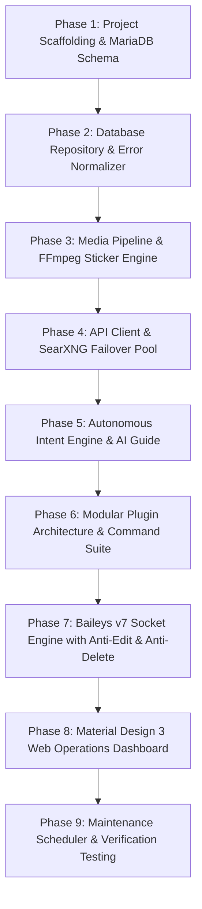

# WHATSAPP_BOT_404_V3 — Master Implementation Plan

**Bot Name:** `WHATSAPP_BOT_404_V3`  
**Creator & Owner:** **Rutaab**  
**Architecture:** Modular, Local-First, Zero-Crash Baileys Automation Engine  
**Branding:** *Powered by V3-ARCHITECTURE*  

---

## 1. Executive Summary & Goals

**WHATSAPP_BOT_404_V3** is a complete, modern rewrite of the bot built for speed, privacy, low resource consumption (< 800 MB RAM), and deep intelligence.

### Core Pillars:
1. **Total Database & Media Logging**: Every single incoming/outgoing message, edit, revocation, raw JSON payload, and downloaded media file is stored simultaneously in MariaDB and local disk.
2. **Anti-Edit Engine (`.antiedit`)**: Intercepts edited WhatsApp messages, fetches the original text from MariaDB, and sends a side-by-side comparison (*Original* vs. *Edited*) to Rutaab.
3. **Anti-Delete Engine (`.antidelete`)**: Recovers deleted messages, photos, videos, and voice notes, forwarding them to Rutaab.
4. **Autonomous Intent Engine**: Executes user requests written in natural language (e.g., *"download this video"*, *"make this a sticker"*, *"transcribe this audio"*) without requiring dot prefixes.
5. **Priority & "Rutaab" Recognition**: Detects mentions of "Rutaab" or urgent keywords in any chat and sends immediate priority push notifications to Rutaab's direct chat.
6. **SearXNG Web Search (`.search`)**: Aggregates Google, Bing, and DuckDuckGo to deliver the top 10 search results with 0 MB local RAM overhead.
7. **Free Multilingual Speech Transcription**: Uses Groq Whisper Large v3 (100% free) with near-instant voice-to-text across 99+ languages.
8. **Interactive Localhost Web Dashboard (`http://127.0.0.1:8788`)**: Material Design 3 interface for viewing live messages, playing voice notes, inspecting edit diffs, and managing bot toggles visually.
9. **Strict Hardware Budget (< 800 MB RAM)**: Direct-to-disk stream piping, 512 MB Node heap limit, and ephemeral FFmpeg workers keeping active usage at ~150 MB – 250 MB.

---

## 2. Project Specification Documents

All technical details, command lists, and output formatting are documented across these 4 companion files:

* [**`COMMANDS.md`**](file:///c:/Users/Fahad/.gemini/antigravity/scratch/WHATSAPP_BOT_404/COMMANDS.md) — Command catalog, natural language task triggers, on/off toggles, and Rutaab priority rules.
* [**`OUTPUT_PREVIEWS.md`**](file:///c:/Users/Fahad/.gemini/antigravity/scratch/WHATSAPP_BOT_404/OUTPUT_PREVIEWS.md) — Visual mockups of WhatsApp messages (`.menu`, `@bot` AI Guide, Anti-Edit diffs, SearXNG results).
* [**`TECH_STACK.md`**](file:///c:/Users/Fahad/.gemini/antigravity/scratch/WHATSAPP_BOT_404/TECH_STACK.md) — Technology stack, system tools, external APIs, and `.env.example` mapping.
* [**`MEMORY_OPTIMIZATION.md`**](file:///c:/Users/Fahad/.gemini/antigravity/scratch/WHATSAPP_BOT_404/MEMORY_OPTIMIZATION.md) — Memory architecture and safeguards guaranteeing the bot stays well under 800 MB RAM.
* [**`API_CATALOG.md`**](file:///c:/Users/Fahad/.gemini/antigravity/scratch/WHATSAPP_BOT_404/API_CATALOG.md) — Complete endpoint documentation for ahm7xmakki.com APIs and flexible argument customization options.

---

## 3. Step-by-Step Implementation Roadmap

### Phase 1: Project Scaffolding & Database Schema
* Set up `package.json` (v3.0.0, ES modules, TypeScript 5.9, `@whiskeysockets/baileys` v7).
* Configure `tsconfig.json` for strict `NodeNext` module resolution.
* Establish `sql/schema.sql` with auto-migration support:
  * `bot_messages` (with `is_from_me`, `media_path`, `raw_message`, `revoked_at`)
  * `bot_edits` (message ID, original text, edited text, timestamp)
  * `bot_ai_interactions` (prompt, response, source)
  * `bot_settings` (`anti_delete_enabled`, `anti_edit_enabled`, `prefix`, `retention_days`)
  * `trusted_entities`, `api_usage`, and `bot_audit_log`
  * `user_game_profiles` (User ID, total games, wins, losses, draws, XP score, rank)
  * `user_game_history` (User ID, game name, opponent, result, points delta, timestamp)

### Phase 2: Database Repository & Centralized Error Normalizer
* **`src/db.ts`**: High-performance `mysql2/promise` repository with automatic table verification, reconnection handling, message lookup, edit diff logging, and audit tracking.
* **`src/ops.ts`**:
  * Health server on port `8787` (`/health`, `/ready`).
  * Process telemetry (RSS memory, heap usage, uptime).
  * In-memory rate limiting and global unhandled rejection shields.
* **`src/error-handler.ts`**: Universal error parser that normalizes API failures (Cloudflare blocks, HTTP 4xx/5xx, timeouts) into friendly WhatsApp notices while saving full technical JSON and stack traces to MariaDB.

### Phase 3: Media Pipeline & FFmpeg Sticker Engine
* **`src/media-pipeline.ts`**:
  * Converts images and videos (<10s) to 512x512 WebP WhatsApp stickers.
  * Injects custom EXIF chunk with Pack Name and Author metadata (`Rutaab / BOT_404`).
  * Converts audio files into WhatsApp voice notes (Opus OGG with PTT header).
  * Extracts MP3 audio tracks from videos.
  * Ephemeral process management (FFmpeg spawned on-demand and killed immediately to free RAM).

### Phase 4: API Client, Downloader Fallback & SearXNG Pool
* **`src/api.ts`**:
  * Pointed to internal backend for AllDL, TTS, WebSnap, Vision AI, Wikipedia PDF, Handwriting, Medicine, and Entertainment.
  * **Multi-Engine Downloader Fallback**: When `ahm7xmakki.com/api/alldl` encounters YouTube cipher or 403 blocks, the bot seamlessly fails over to **Cobalt API** (`https://api.cobalt.tools`) or direct music CDNs (JioSaavn) for 320kbps MP3s.
  * **SearXNG Client**: Auto-rotating public pool (`https://searx.be`, `https://search.ononoki.org`, `https://searx.tiekoetter.com`) returning clean top 10 search results with 0 MB local RAM overhead.
  * **Groq Whisper Client**: Free speech-to-text API integration for instant voice note transcription across 99+ languages.

### Phase 5: Autonomous Intent Engine & AI Guide
* **`src/ai-guide.ts`**:
  * `@bot <question>` interactive guide engine with prompt containing complete bot commands, usage instructions, and tips.
  * Local rule-based knowledge fallback engine guaranteeing 100% uptime even if external AI APIs are offline.
* **`src/intent-engine.ts`**:
  * Zero-prefix natural language action parser: detects download links, sticker creation requests, transcription requests, and web searches directly from user chat.
  * Priority filter: detects "Rutaab" mentions and urgent keywords, forwarding priority notifications to Rutaab.

### Phase 6: Modular Plugin Architecture & Command Handlers
* **`src/plugin.ts`**:
  * Standardized `PluginCommand` and `PluginManager` with execution context (`reply`, `replyMedia`, `isOwner`, `isAdmin`, `isGroup`, `cooldown`).
* **`src/plugins/`**:
  * `general.ts`: `.help`, `.menu`, `.ping`, `.speed`, `.runtime`, `.owner`
  * `privacy.ts`: `.vv`, `.antidelete`, `.antiedit`, `.antistatus`, `.del`
  * `group.ts`: `.tagall`, `.hidetag`, `.kick`, `.add`, `.promote`, `.demote`, `.mute`, `.unmute`, `.link`, `.revoke`, `.groupinfo`
  * `media.ts`: `.s`, `.sticker`, `.wm`, `.toimg`, `.tovn`, `.tomp3`
  * `tools.ts`: `.search`, `.dl`, `.screenshot`, `.snapinfo`, `.wiki`, `.hand`, `.mail`, `.med`, `.movie`, `.manga`, `.novel`, `.courses`
  * `status.ts`: `.status` (post to WhatsApp Status for Rutaab), `.groupstatus` (bulletin), `.autostatus`
  * `fun.ts`: User ID-based gaming suite: `.quiz` / `.answer` (+10 XP), `.tictactoe` (+15 XP), `.rps` (+5 XP), `.profile` (User ID stats, XP, ranks), `.gamehistory` (last 8 matches), `.leaderboard` (global top 10), `.roll`, `.flip`, `.hack`

### Phase 7: Baileys v7 Socket Engine with Anti-Edit & Anti-Delete
* **`src/whatsapp.ts`**:
  * Multi-File auth state supporting optional **Pairing Code** (`PAIRING_NUMBER=...`) or terminal QR code fallback.
  * **Universal Message Interceptor**: Streams incoming media directly to disk (`data/media/`) and logs full records to MariaDB.
  * **Edit Interceptor (`MESSAGE_EDIT`)**: Compares new text against stored original text in MariaDB, records edit in `bot_edits`, and alerts Rutaab.
  * **Revoke Interceptor (`REVOKE`)**: Fetches deleted text/media from MariaDB and forwards recovery notice to Rutaab.
  * **Intent & Command Dispatcher**: Routes messages through the priority filter, intent engine, and plugin manager.

### Phase 8: Material Design 3 Web Operations Dashboard
* **`src/dashboard.ts`**:
  * Lightweight HTTP server bound to `127.0.0.1:8788`.
  * Single-Page Material Design 3 Dark Theme interface.
  * **Tabs**:
    1. *Overview*: Connection state, RAM/CPU load, MariaDB status, message counters.
    2. *Live Messages & Media Explorer*: Table of all logged messages with inline photo viewer, audio player, and video previews.
    3. *Anti-Delete & Anti-Edit Feed*: Dedicated stream of deleted and edited messages with side-by-side diff cards.
    4. *Control Panel*: Clickable toggles for Anti-Delete, Anti-Edit, Anti-Status, Auto-Status, Prefix, and Retention Days.
    5. *Trusted Contacts & Audit Log*: View whitelisted numbers and live activity logs.

### Phase 9: Automated Maintenance & Verification Testing
* Background retention scheduler running every 6 hours to prune media and database rows older than `MESSAGE_RETENTION_DAYS`.
* Comprehensive unit tests in `test/`:
  * `test/commands.test.ts` (command parsing and aliases)
  * `test/intent.test.ts` (natural language action extraction)
  * `test/db.test.ts` (schema and edit/revoke repository operations)
  * `test/media-pipeline.test.ts` (WebP EXIF generation)
* Full TypeScript compilation check (`npm run lint` & `npm run build`).

---

## 4. Verification & Acceptance Criteria

| Feature | Verification Method | Expected Result |
|---|---|---|
| **Zero-Crash Compilation** | `npm run build` | Compiles clean to `dist/` with 0 TypeScript errors. |
| **All Tests Pass** | `npm test` | All unit tests pass across command parsing, intent engine, and DB helpers. |
| **Memory Budget** | `process.memoryUsage().rss` | Idle usage < 180 MB, active usage < 250 MB (well below 800 MB limit). |
| **Anti-Edit Alert** | Edit message in WhatsApp | Bot captures event, logs to `bot_edits`, and sends side-by-side diff to Rutaab. |
| **Anti-Delete Alert** | Delete for everyone | Bot recovers message and media from disk and forwards to Rutaab. |
| **Autonomous Intent** | Send *"download https://..."* | Bot triggers downloader and returns video without requiring `.dl`. |
| **SearXNG Search** | Send `.search Node.js guide` | Returns top 10 search results with descriptions and clickable links. |
| **Dashboard UI** | Open `http://127.0.0.1:8788` | Renders Material Design 3 dashboard with live metrics, media player, and toggle controls. |
